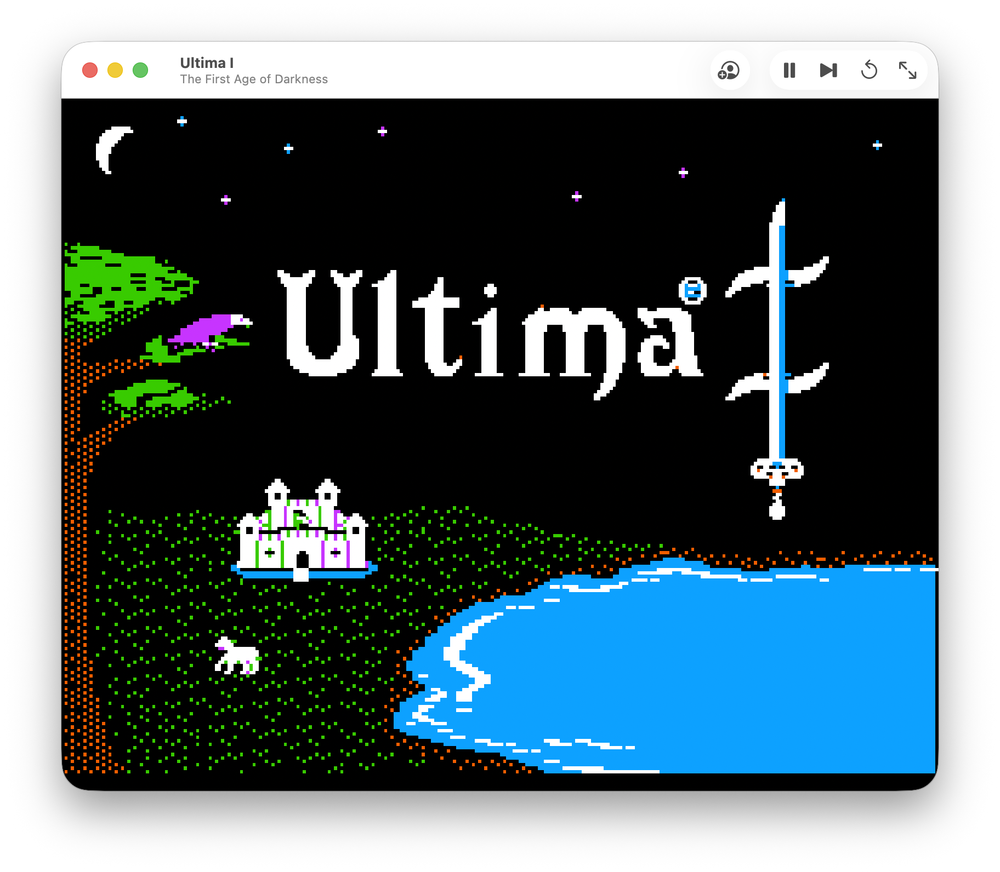
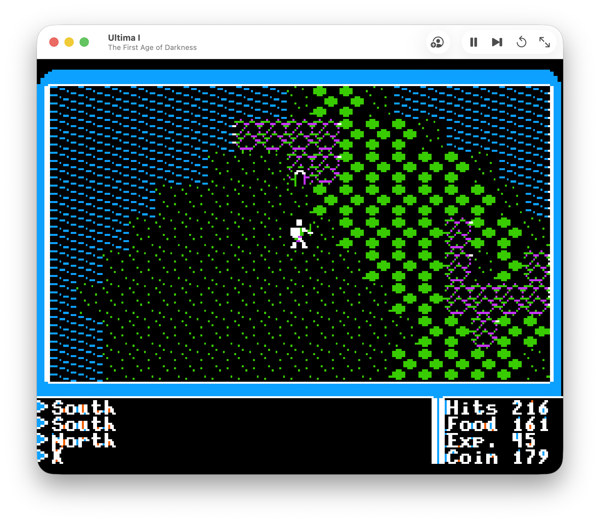
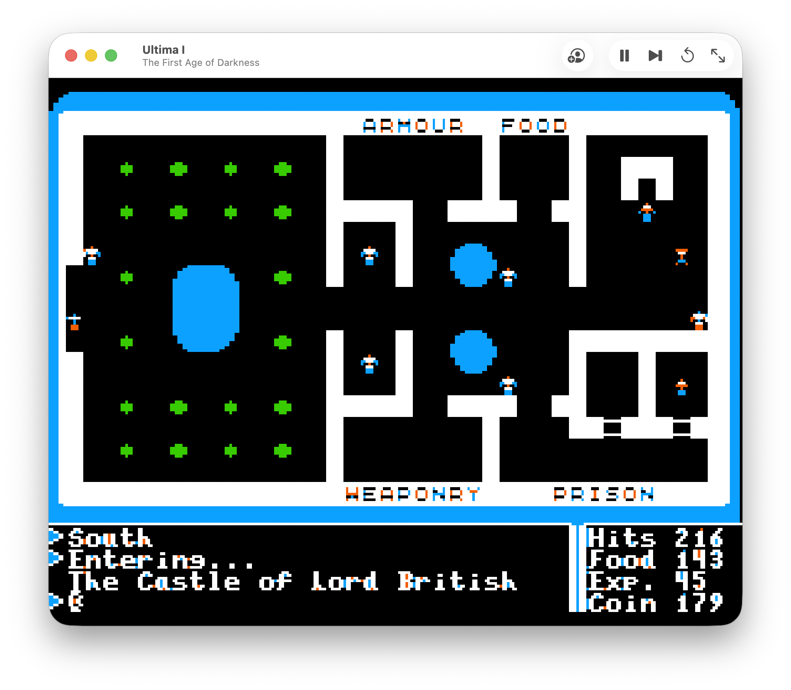
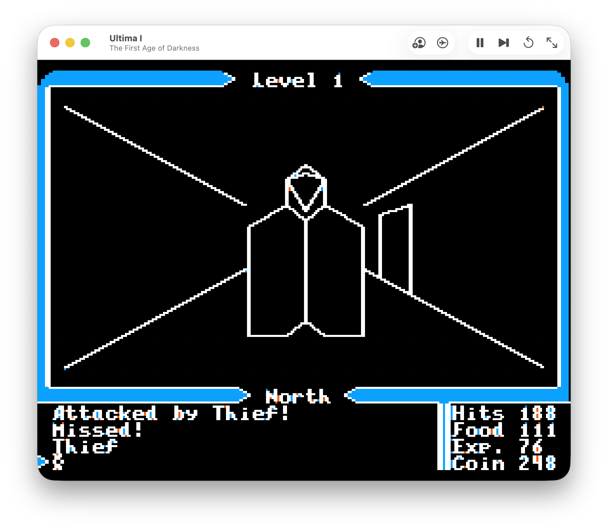

# Ultima I: Apple II reverse engineering and macOS adaptation

An ongoing study of the **1986 Apple II ProDOS release of Ultima I**, with a
native macOS adaptation built from Ghidra-assisted, address-preserving translation
into Swift. The aim is to retain the original graphics, English text, keyboard
commands, game rules and speaker effects.

ChatGPT and Codex have provided substantial help with reverse engineering,
implementation and testing. Project direction, fidelity decisions and hands-on
playtesting are guided by the maintainer.

## Screenshots

Actual gameplay captures from the native macOS app, retaining the Apple II
artwork, English text and screen layout. Click an image for the full-size view.

[](screenshots/title.png)

| Exploring Sosaria | The Castle of Lord British | First-person dungeon exploration |
| --- | --- | --- |
| [](screenshots/sosaria.png) | [](screenshots/lord-british-castle.png) | [](screenshots/dungeon.png) |

## Current state

The native app connects the intro, character creation and save/load, Sosaria,
towns, castles, dungeons, space flight, and the time-machine/ending sequence.
Original Apple II speaker signals now produce macOS audio. Gameplay currently
runs at a deliberately brisk pace.

**This is a work in progress.** Module integration is ahead of exhaustive gameplay
validation. Some space and finale tests use explicit fixtures; normal acquisition
of every prerequisite and every gameplay branch has not been verified.
See [current status and limitations](docs/status.md).

## Build locally

You need macOS, Python 3, a Swift toolchain, Ghidra with its required Java runtime,
and your own locally extracted files from the supported game release.

```sh
# From the repository root, after placing your own files in extracted/:
export ULTIMAI_GHIDRA_HOME="/path/to/ghidra"
python3 tools/build_macos_app.py
open "build/Ultima I.app"
```

See [build requirements, controls and saves](macos/README.md). The repository does
not include the game disk, extracted assets, generated translations or app bundle.
Those remain local. It does not provide a self-contained download of the game.

## Start reading

| Interest | Guide |
| --- | --- |
| Run the macOS app | [Build and controls](macos/README.md) |
| Understand the implementation | [Architecture](docs/architecture.md) |
| See what is actually verified | [Status and limitations](docs/status.md) |
| Explore the original program | [File map](docs/file-map.md), [module dependencies](docs/dependency-map.md), [disassembly index](disasm/README.md) |
| Find detailed evidence | [Documentation index](docs/README.md), including English reports and Korean research notes |
| Contribute or reproduce a check | [Developer guide](CONTRIBUTING.md), [tool guide](tools/README.md) |

## Repository layout

- `macos/`: handwritten Swift host, graphics and audio output, and native checks.
- `disasm/`: reviewed assembly fragments and file-by-file evidence.
- `docs/`: implementation reports, reference material and historical research.
- `tools/`: Ghidra export, translation, extraction, tracing and verification tools.
- `screenshots/`: gameplay screenshots supplied by the maintainer for this preview.
- `port-prototype/`: earlier focused experiments; not the current application.
- `extracted/`, `disk/`, `build/`: private local inputs and outputs, ignored by Git.

## Original material

Ultima I and its original material belong to their respective rights holders.
This is an independent project. Use your own copy of the supported release for
local work. Do not submit original assets, disk images, generated byte listings,
reference snapshots or asset-containing app bundles.

Published technical notes and reviewed fragments are research artifacts, not a
claim that the game or its assets have been released under an open-source license.
