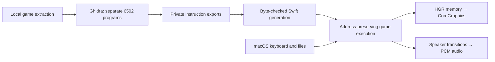
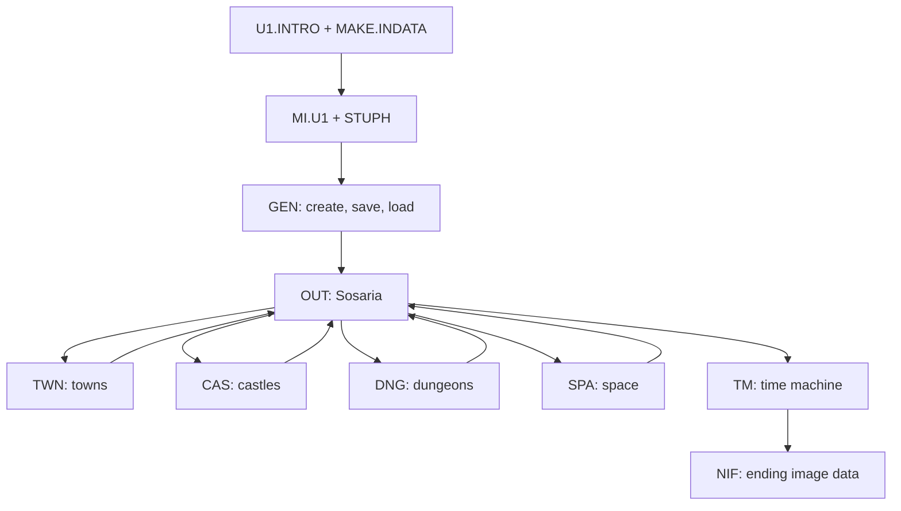

# Architecture

This is an English overview of the current native implementation. Original-code
addresses are retained so a runtime failure can be traced back to a specific file
and instruction. For evidence boundaries, read [status](status.md).

## From the original files to Swift

The native app does not boot an Apple II disk image or execute ProDOS. It executes
Swift blocks generated from Ghidra instruction exports. A small host provides
memory, CPU operations, selected file/ROM services, keyboard input, graphics and
audio output. This remains a compatibility-oriented translation, with a CPU-like
state and original addresses; it is not a rewrite into high-level RPG systems.

Apple II files mix code, text, tables and graphics. Overlapping instructions and
self-modified operands also occur. The runtime exporter includes speculative
instruction candidates, and the generators check their bytes against the local
extraction. **A candidate is not a confirmed code classification.** Only reached
PCs execute; unknown PCs and unexpected opcode changes stop with an error.

## Game flow and overlays

`GEN`, `OUT`, `TWN`, `CAS`, `DNG`, `SPA` and `TM` share the load address `$8956`.
They are mutually exclusive overlays, not simultaneously resident functions in
one static image. `MI.U1` retains common engine code below that boundary, while
`STUPH` provides shared services through its `$1583–$15E8` vector table.

Each gameplay overlay runs its own input/command/update loop. Shared services
handle command decoding, state display, text, randomness, portions of turn
accounting, and input. Dungeon first-person rendering and outdoor tile rendering
follow different original paths. The port executes those original paths rather
than replacing them with one generic scene renderer.

The host maintains a 64 KB memory image. It retains original scratch/zero-page
reuse, overlay replacement, map buffers and HGR pages. Catalog load addresses
alone do not describe memory lifetimes: intro support relocates code, and the
ending reuses regions that normally hold engine/player state. See the
[file map](file-map.md) and [dependency map](dependency-map.md).

## Native boundaries

| Area | Implementation |
| --- | --- |
| Execution | [StartupMachine.swift](../macos/Sources/StartupMachine.swift): registers, flags, addressing, memory and startup scheduling |
| Game routing | [GameFlow.swift](../macos/Sources/GameFlow.swift): overlay selection, original instruction execution and host service boundaries |
| Files and saves | [HostFiles.swift](../macos/Sources/HostFiles.swift): local resource reads and the original 458-byte player record |
| Graphics | [HGRRenderer.swift](../macos/Sources/HGRRenderer.swift): HGR RAM to artifact-color pixels; original game code writes screen RAM |
| Audio | [AppleSpeaker.swift](../macos/Sources/AppleSpeaker.swift): `$C030` transitions to PCM and macOS output |
| Window and input | [Application.swift](../macos/Sources/Application.swift): AppKit window, key events, timer, menus and output scheduling |
| Isolated tests | [TestSession.swift](../macos/Sources/TestSession.swift): temporary SPA/TM sessions separate from the real player record |

Generated Swift and bundled original resources stay under ignored `build/`.
The startup generator and gameplay generator are
[transcribe_startup.py](../tools/transcribe_startup.py) and
[transcribe_game_flow.py](../tools/transcribe_game_flow.py).

## Time, input and persistence

The UI advances execution at 60 Hz with instruction budgets; this is not
cycle-accurate game pacing. The current fast tempo is intentional. Audio uses an
independent CPU-cycle estimate to preserve effect pitches; its queueing policy
and timing limits are described in [native audio](native-audio.md).

Key events feed the original keyboard latch and queue routines. Original
English prompts and HGR text remain part of game execution. Native menus provide
playback, mute and diagnostic controls outside the game canvas.

Player records are stored at
`~/Library/Application Support/UltimaI/Characters/U1.VARS`.
The game has one save slot; confirmed character creation and outdoor Q saving
replace that record. Test sessions use separate temporary directories and retain
the suspended normal machine, including unsaved progress.

## How behavior is checked

Native headless runs build the actual screens and records from local resources.
Independent original-emulator snapshots provide comparison data; they are not
runtime inputs to the app. Checks compare selected RAM ranges, rendered pixels,
state transitions and save bytes. Audio checks execute original effect routines
and compare two independently measured transition intervals.

Integration, code/data understanding and branch coverage are separate claims.
A connected module or byte-matching export does not establish complete fidelity.
