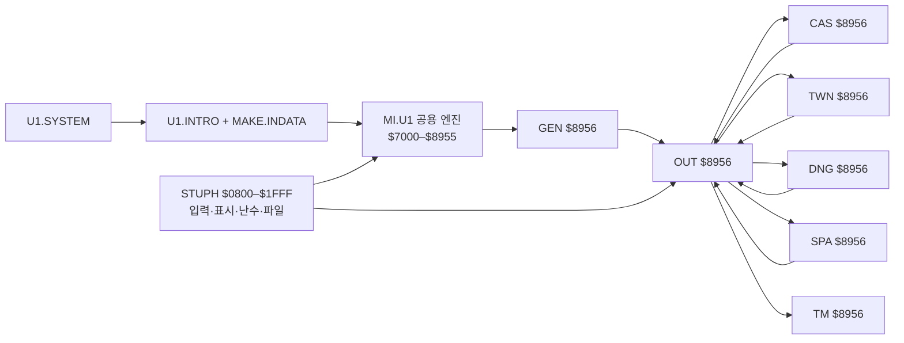

# Ultima I Apple II 역공학 종합 리포트 — 2026-10-21

## 결론과 판정 기준

대상은 이 저장소의 **1986년 Apple II ProDOS판 Ultima I**다. 부트부터 주요 장면의 첫 루프까지의 실행 구조, 공용 입력 해석과 여섯 장면의 간접 핸들러 표, 저장 레코드의 일부 필드, 여러 게임 규칙의 실제 상태 변화를 연결했다. 이 결과는 **핵심 구조와 선택한 경로를 설명하는 분석 기반**이다. 모든 도달 가능 코드·데이터, 전체 게임 규칙, 화면·소리·타이밍을 대조할 수 있는 **완결된 macOS 포팅 명세는 아직 아니다**.

이 문서에서 **실행**은 원본을 로드한 에뮬레이터의 입력·PC·메모리 스냅샷 확인, **바이트**는 검토한 어셈블리를 재조립해 추출 파일과 일치시킨 확인, **정적**은 원본의 주소·테이블·명령 해석, **Ghidra 후보**는 자동 분석 결과를 뜻한다. 통제 실험에서 메모리 값을 바꾼 경로는 자연 입력만으로 이어진 경로와 구분한다. 각 주장의 주소와 재현 절차는 링크한 문서·검증기에 둔다.

부트부터 결말까지 실제 플레이 순서로 **코드·키보드·그래픽·소리·메모리**를 함께 읽으려면 [게임 진행 중심 리포트](gameplay-flow-report.md)를 먼저 본다. 이 문서는 파일별 범위와 포팅 준비도 판정의 근거를 보완한다.

## 1. 재현성과 분석 범위

| 항목 | 현재 확인 결과 | 해석과 한계 |
| --- | --- | --- |
| 원본 파일 | 게임 파일 15개, 합계 103,376바이트; 별도로 `PRODOS` 1개 | 로컬 16개 추출 파일이 CiderPress 재추출과 일치한다. 원본 파일은 공개 저장소에 없다. [파일·로드 주소표](file-map.md), [기준점](baseline.md) |
| 바이트 일치 어셈블리 | 12개 모듈의 98개 조각, 중복 제외 4,216바이트 | 선택한 주소의 정확한 근거이며 전체 코드 커버리지가 아니다. 일부 조각에는 의도된 인라인 데이터와 짧은 표가 있다. [주소별 색인](assembly-atlas.md) |
| Ghidra 12.1.4 | 시간 단계와 오버레이를 분리한 12개 6502 프로그램; 함수 후보 518개, 직접 호출 후보 1,061개 | 검증된 인라인 데이터와 간접 핸들러·공용 벡터 및 `SPA V` 항법 표를 반영한 후의 검토 목록이다. 처음 212개/513개보다 늘었지만 정확도·완료율을 뜻하지 않는다. [호출 지도](ghidra-call-atlas.md) |
| 간접 명령 연결 | 공용 키 26개 × 여섯 오버레이 = 일반 포인터 156개, `SPA V` 별도 26개, 합계 182개를 원본과 Ghidra 양쪽에서 대조 | 중복 대상이 있어 포인터 수가 함수 수를 뜻하지 않는다. `GEN` 메뉴는 별도 경로다. [일반 명령 행렬](command-dispatch-matrix.md), [항법 표](spa-view-commands.md) |
| 공용 I/O 진입 | `STUPH $1583–$15E8`의 34개 JMP 벡터를 바이트로 확인 | 벡터의 기능은 일부만 실행 검증했다. [서비스 지도](shared-services.md) |
| 통합 검증 | `tools/check_all.py`의 107개 검사 구간 통과; Ghidra TSV 검증 별도 통과 | 여러 검사는 로컬 비공개 스냅샷이 있어야 판정 가능하다. 통과한 시나리오 밖의 동작을 보증하지 않는다. |

`U1.SYSTEM $21D6–$2222`의 시작 파일 핸드오프도 재조립해 바이트 일치를 확인했다. `MAPCHARS`, `TCMAPS`, `NIF`는 코드 조각 수에 포함하지 않는 데이터 파일이다. [파일별 코드·데이터 장부](code-data-ledger.md)는 검증 코드 4,221바이트와 검증 데이터 487바이트를 Ghidra 후보에서 분리한다. 나머지 자동 분석 분류는 **후보**다. 파일 크기 대비 재조립 바이트 비율을 역공학 완료율로 계산하지 않는다.

## 2. 실행 구조: 시간에 따라 바뀌는 메모리

`U1.SYSTEM → U1.INTRO → MAKE.INDATA → MI.U1 → STUPH → GEN → OUT`의 부트·로드를 실행했다. 게임 중 `MI.U1 $7000–$8955`와 `STUPH`가 남고, `GEN/OUT/CAS/TWN/DNG/SPA/TM`은 **한 번에 하나만** `$8956`부터 로드된다. `MI.U1`의 최초 `$8956–$89BC` 로더 꼬리도 첫 오버레이에 덮인다. 따라서 주소만으로 함수를 식별할 수 없고 **파일·주소·실행 시점**을 함께 기록해야 한다. `$0800`의 인트로/글리프/공용 지원과 `$4000`의 지도/결말 데이터도 시점별로 겹친다. [로드 의존 지도](dependency-map.md), [실행 구조](execution-architecture.md), [메모리 수명](memory-and-zero-page.md).

메인 루프는 공통적으로 **입력 → 공용 키 해석 `$82A2` → 현재 모듈의 16비트 포인터 표 → 핸들러 → 장면별 턴·표시 후처리 → 입력** 순서다. `OUT`은 `$8A6C → STUPH $15C5`, `CAS/TWN/DNG/SPA`는 `$15C2` 계열을 쓴다. `TM`은 자체 `$9815/$9827` 입력 경로를 거쳐 공용 해석기로 합류한다. 같은 Up 키의 `OUT/DNG/CAS/TWN` 한 턴과 `SPA/TM` 첫 Space 턴에서 실제 핸들러 및 다음 입력 복귀를 확인했다. [한 턴 비교](turn-contracts.md), [명령 행렬](command-dispatch-matrix.md).

같은 해석기를 쓴다고 상태와 입출력이 같지는 않다. 야외는 `$6000`의 64×64 지도와 공유 턴 값을 주로 갱신한다. 성·마을은 실내 지도와 `$00/$01` 좌표를 쓴다. 던전은 `$B099`의 11×11 작업 지도, `$A4E8/$A4E9` 로컬 좌표와 자체 몬스터 턴을 쓴다. 첫 Up 턴에서 `CAS/TWN`은 동일한 공유 상태 주소 집합을 바꿨지만 화면 RAM 변경량과 픽셀 결과는 달랐다. [턴 계약](turn-contracts.md), [던전 지도](dungeon-map.md).

## 3. 확인된 게임 동작과 남은 규칙

| 범위 | 확인된 동작 | 주요 미확인 부분 |
| --- | --- | --- |
| 생성·불러오기 `GEN` | 새 캐릭터의 능력치 배분, 인종·성별·직업·이름 선택, `U1.VARS` 저장, `B` 불러오기와 `OUT` 전환을 실행·부분 재조립 | 다른 선택지의 보너스·제약, 이름 경계, 실패 파일과 손상 레코드, 모든 초기 필드. [GEN](../disasm/GEN.md), [레코드](../disasm/U1.VARS.md) |
| 야외 `OUT` | 첫 루프, 네 방향·Space·Q, 지도 타일 조회, 성·마을·던전 진입, 탈것 탑승 관문, 사망 뒤 부활, 동적 물체 삽입과 저장을 확인. 통제된 네 방향 경계에서 세계 구역 `0→1/3/2/2`, 각각의 지도 교체와 좌표 랩을 실행 | 지형·조우·탈것·전투·마법·경제의 명령별 전체 규칙, 자연 입력으로 경계에 이르는 경로. [OUT](../disasm/OUT.md) |
| 성·마을 `CAS/TWN` | 이동·충돌·성 경비병 전투·사망/부활, 마을 식량 가격과 화폐 부족 경계, 지도·글리프 로드를 확인 | 다른 상점·NPC·성 대화, 재고와 거래, 방문 조건, 모든 전투 분기. [CAS](../disasm/CAS.md), [TWN](../disasm/TWN.md) |
| 던전 `DNG` | 1–3층 생성·계단·이동, 11×11 지도와 배우 슬롯, 여러 몬스터 턴·명중/피해·제거/재생성을 검증 | 전체 생성 난수열, 다른 층·지형·함정·보물·몬스터 종류, 죽음·탈출의 모든 경우. [지도](dungeon-map.md), [전투](dungeon-combat.md) |
| 우주 `SPA` | `OUT`의 통제된 B 탑승으로 파일 로드·입력 루프·첫 Space 턴 확인. 방향 이동·회전과 Fuel 차감 342바이트를 재조립하고, 같은 시작 상태의 네 방향키를 독립 실행해 좌표·방향·Fuel `5/2` 소모를 확인. Up의 Fuel 0 거절과 Fuel 4/5의 소모 후 0 포화를 통제 실행으로 확인. 일반 고유 명령 6개의 실제 목적지와 I/V/Z의 내부 경유지를 확인. `V` 별도 26키 표의 14개 고유 대상을 모두 첫 화면에서 실행해 디스패치를 확인했다. Space·방향 네 개·H는 항법 속도 `±4`, Fuel 2, HyperJump Fuel 100 경계까지 확인. F는 Fuel 10 소모, V는 일반 SPA 입력으로 복귀, Ctrl-A·N은 공용 상태 바이트를 변경 | 방어막·도킹·적·다른 상태, I/Z의 전체 표시·입력 사이클과 나머지 명령의 실제 규칙. [SPA](../disasm/SPA.md), [항법 명령](spa-view-commands.md) |
| 시간·결말 `TM` | 네 도입 페이지, 메인 입력, 보석 파괴 관문, 공격·후퇴/재교전 일부, HP만 낮춘 통제 승리와 `NIF` 로드 확인. `NIF`가 192×40 HGR 행이며 7,680바이트를 모두 소비함을 검증. 아홉 중간 시점에서 쓰기 대상 하단 행의 바이트 일치, 화면 뒤쪽 페이지에 쓰고 전환하는 순서, 모든 줄의 CPU 사이클 간격을 확인. 최종 HGR 1페이지와 실제 에뮬레이터 프레임 107,520픽셀의 색이 파일에서 계산한 값과 일치 | 자연 획득한 선행 조건에서의 전 경로, 전투 전반, 실제 Apple II 아날로그 색·소리, 결말의 다른 진입 상태. [TM](../disasm/TM.md), [NIF](../disasm/NIF.md), [의뢰·결말](quest-and-final-craft.md) |

의뢰 상태 `$7EA9–$7EB0`은 `0→1→$FF→0` 전이를 보인다. 홀수 의뢰 **하나**는 정상 입력으로 성 수락 → 던전 3층 종류 5 처치 → 성 복귀·빨간 보석 수령까지 연결했다. 나머지 보석과 공주·최종 탈것은 정적 연결 및 일부 통제 실행으로만 확인했다. `TM`의 승리 분기는 보석 관문을 만족시킨 뒤 몬데인 HP **한 필드만** 낮춰 검증했다. 자연스러운 전체 플레이 완주를 했다는 뜻은 아니다. [의뢰·탈것·승리 근거](quest-and-final-craft.md).

## 4. 상태·데이터·입출력의 현재 계약

| 분야 | 확보한 구조 | 포팅 전에 필요한 검증 |
| --- | --- | --- |
| 플레이어 저장 | `U1.VARS` 458바이트가 `$7E6D–$8036`에 대응한다. 생성 저장, 야외 `Q`로 변경 저장, `GEN B` 재로드의 바이트 왕복을 확인했다. HP·식량·Coin·능력치·의뢰·보석·동적 물체의 일부 필드를 식별했다. [직접 접근 후보 지도](player-access-atlas.md)는 349곳의 명령·61곳의 주소를 모았다. [레코드](../disasm/U1.VARS.md), [상태](player-state.md) | 137바이트 접두부의 나머지 필드, 인덱스·간접 접근, 저장 시점 전부, 손상·디스크 오류, 재시작과 사망의 모든 상태 보존. |
| 제로 페이지 | `$00/$01`은 야외·성·마을 좌표로 쓰이지만 던전은 별도 `$A4E8/$A4E9`를 쓴다. `$72/$73`은 야외 지도 포인터, 성 임시 좌표·전투 값, 마을 16비트 가격 등으로 재사용된다. `$74–$78` 키 버퍼와 `$24/$25` 텍스트 커서 관계를 확인했다. [수명 지도](memory-and-zero-page.md) | 함수 호출 경계마다 읽기/쓰기·보존 범위, 간접 포인터의 수명, 자기 수정 코드, 소프트 스위치와의 상호작용. |
| 지도·그림 | `TCMAPS` 10개 × 764바이트 슬롯, 실내 768바이트 복사; 마지막 4바이트는 상속 RAM이다. `MAPCHARS`는 128글리프 × 8 스캔라인이고 성의 한 글리프 화면 효과를 대조했다. 던전 지도는 11×11. `NIF`는 280×192 픽셀의 7,680바이트 연속 HGR 행으로, 결말 마지막 화면과 아홉 중간 시점의 쓰기 대상 하단 행이 파일과 일치. 두 HGR 페이지를 번갈아 화면 뒤에서 준비하며 줄당 약 119,210 에뮬레이트 CPU 사이클이 든다. 최종 560×192 에뮬레이터 프레임은 검정·흰색·파랑·주황 네 색으로 전 픽셀 일치한다. [TCMAPS](../disasm/TCMAPS.md), [MAPCHARS](../disasm/MAPCHARS.md), [NIF](../disasm/NIF.md), [던전](dungeon-map.md) | 지도 타일과 모든 화면 픽셀·색/페이지의 대응, 마지막 4바이트의 후속 소비자, 실제 Apple II 아날로그 색. |
| 키·화면·소리 | `$C000/$C010` 키 래치에서 버퍼·공용 해석·핸들러까지 이어졌다. 한 문자 출력에서 화면 RAM 12바이트 변경과 다음 프레임 픽셀 해시 변화를 관측했다. 성 글리프 한 패턴의 14×8 픽셀 효과도 대조했다. `STUPH`의 아홉 소리 효과 간접 표와 네 바이트 대기열 저장 영역을 150바이트 재조립했다. 효과 두 개의 `$C030` 접근 16/50회와 6,441/1,666 사이클 간격을 통제 실행으로 확인했다. [서비스](shared-services.md) | 키 유지·반복·대기 타이밍, 화면 모드·색 전체, 게임 이벤트와 소리 ID의 대응, 다른 효과와 실제 오디오, 프레임과 턴의 관계. |

던전 생성에서 관찰한 `$72,$3C`은 **제로 페이지 주소가 아니라** 일반 RAM `$A504/$A505`에 기록된 시드 **값**이다. 이 구분처럼 같은 숫자라도 주소, 저장된 값, 다른 장면의 주소 수명을 혼동하면 포트의 상태 모델이 틀어진다. [시드 근거](dungeon-map.md#first-generator-seed).

입력 경로를 추가로 재조립했다. `STUPH $1D7E–$1DD5`에서 실내의 제한된 키 폴과 `OUT`의 장면 처리 뒤 키 확인은 서로 다른 입구를 갖지만, `$1DAD`의 동일한 버퍼 소비·키 정규화 코드로 합류한다. [$1DD6 자기 수정 준비 루틴을 포함한 연속 바이트 근거](../disasm/STUPH.md)를 참조한다.

야외 장면 처리 `$1C39–$1D63`도 299바이트 연속 재조립했다. 입력 폴에 호출된 이 루틴은 `$6000` 지도에서 19×9 타일 창을 만들고 화면 RAM으로 전개한 뒤 `$1D64` 키 래치로 이어진다. 첫 야외 입력의 원본 실행에서 이 호출 전후로 화면 RAM 5,362바이트가 바뀌고 지도 원본은 그대로였다. [지도 타일→화면 픽셀 대조](outdoor-rendering.md)에서는 한 타일 `$02→$04` 변경이 표시 페이지 전환 뒤 완료 프레임의 158픽셀에 미치는 효과와 비트 0·7이 이 렌더러에서 마스킹됨을 확인했다. 같은 자리의 지형 8종과 이웃 비트·위상을 이용한 HGR 색 계산으로 **10개 완료 프레임의 전체 1,075,200픽셀**을 저장된 화면 RAM과 대조해 일치시켰다. 다른 위치·인접 타일·애니메이션 상태는 추가 검증 대상이다.

## 5. 종합 과정에서 드러난 빈칸과 다음 작업

| 우선 | 부족한 근거 | 다음 산출물과 통과 조건 |
| --- | --- | --- |
| 1 | 파일별 **도달 가능 코드/데이터 경계**가 불완전하다. Ghidra 미분류 바이트가 많고 인라인 문구·테이블을 가짜 명령으로 읽을 수 있다. | 모듈마다 주소 구간을 `검증 코드 / 확인 데이터 / 미분류`로 관리한다. 공용 키 표·핸들러 표부터 다른 간접 표와 `JSR` 뒤 인라인 데이터까지 확장하고, 실제 실행 목표 및 바이트 일치 소스로 교차 확인한다. |
| 2 | 공용 `MI.U1`/`STUPH` 서비스의 **호출 계약**이 부분적이다. | 대표 `OUT` 한 턴과 `DNG` 한 턴의 키 래치 → 명령 → 턴/RNG → 화면 RAM/픽셀·스피커를 읽기/쓰기 주소, 레지스터·플래그, 호출 시점으로 닫는다. 두 모듈의 차이를 포트가 비교 가능한 시나리오로 만든다. |
| 3 | `U1.VARS`의 미분류 필드와 파일 데이터의 소비자가 남았다. | 필드별 초기화·소비·생산·저장 수명 표, `TCMAPS/MAPCHARS/NIF`의 참조와 변환 왕복. 의미 모르는 바이트는 계속 미분류로 둔다. |
| 4 | 게임 규칙은 대표 경로 중심이다. 특히 `SPA`, 상점·전투·마법·월드 이동, 나머지 보석과 공주 경로가 얇다. | [26키 행렬](command-dispatch-matrix.md)의 각 모듈·명령에 전제 조건, 상태·표시 효과, 실패/경계 입력, 실행 증거를 붙인다. 정상 입력으로 얻은 선행 상태와 통제 상태를 구분한다. |
| 5 | 원본과 포트의 **차등 비교 기준**이 아직 충분하지 않다. | 저장 레코드, 메인·보조 화면, 프레임, 소리, 난수·시간을 포함한 기준 시나리오를 정의하고 macOS 구현에서 같은 입력을 재생해 차이를 기록한다. |

현재 성과는 **포트의 핵심 구조를 설계하기에 유용**하다. “원작 충실” 판정은 [포팅 로드맵의 수용 기준](porting-roadmap.md#포팅-준비-수용-기준)을 만족한 뒤에만 내린다. 다음 작업의 성과는 조각·커밋 수보다 **미분류 구간과 미확인 상태·명령 계약이 얼마나 줄었는지**로 측정한다.

## 6. 공개·재현 경계와 이전 문서의 시점

공개 저장소에는 주소, 구조, 검토한 소규모 어셈블리 조각, 검증 도구와 판정 결과만 둔다. `extracted/`, `disk/`, `build/`의 원본 바이너리, 플레이어 디스크, 에뮬레이터 스냅샷, Ghidra 프로젝트/TSV는 비공개다. 로컬에서 `python3 tools/check_all.py`, `python3 tools/ghidra/import_modules.py`, `python3 tools/ghidra/verify_exports.py`로 이번 결과를 재검증한다. Ghidra 검증은 설치된 Ghidra와 로컬 추출 파일이 필요하다.

[이전 진행·투입 점검](progress-audit-2026-10-21.md)의 75조각·2,603바이트·65검사는 **작성 당시 수치**다. [로드맵](porting-roadmap.md)도 작성 후 82조각·2,834바이트에서 현재 값으로 갱신했다. 이 문서의 98조각·4,216바이트·107개 확인된 검사가 현재 범위다. 시간 예산은 이전 점검의 가정치이고, 새 범위에 맞춘 실측 재산정은 하지 않았다. [분석 로그](analysis-log.md)의 순서와 각 파일별 문서를 증거의 세부 기록으로 사용한다.
