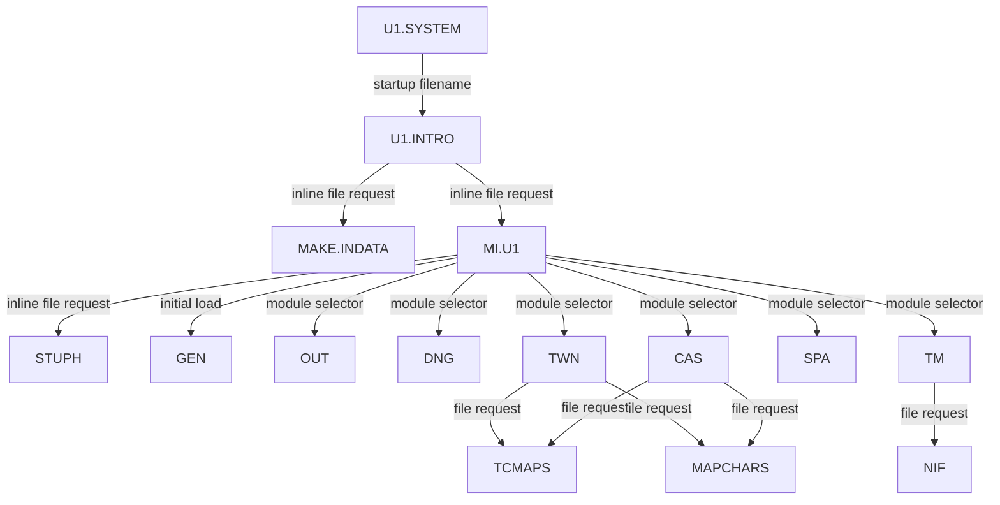

# Dependency map

This map separates **file loads**, **calls into resident code**, and **runtime module transitions**. It is based on the extracted 1986 ProDOS files. A filename next to a call is evidence of a file operation; the exact semantics of the `$B7xx` routines still need tracing.

## File-load evidence

| From | To | Evidence | Confidence |
| --- | --- | --- | --- |
| `U1.SYSTEM` | `U1.INTRO` | Live startup header; runtime `$2220 → $0136 → $0800 → $0F23`, intro entry bytes match extraction | Runtime confirmed on block-equivalent `.po` boot |
| `U1.INTRO` | `MAKE.INDATA` | Runtime `$0F28 → $B70C → $0F37 → $0F41`; loader entry pointer `$BAF2=$1E00`; two copied payload ranges match file bytes | Runtime confirmed on block-equivalent `.po` boot |
| `U1.INTRO` | `MI.U1` | Animation poll `$0B23` and later key loop `$1039` reach `$0B50`; non-`$9B` path calls `$B70C` at `$0B57`, inline name `$0B5A` | Runtime confirmed for ASCII `A` through `$7000`, full 6589-byte match; later loop pending |
| `MI.U1` | `STUPH` | `$8975` calls `$B703`; inline name starts at `$8978` | Runtime confirmed; 6144-byte match at `$0800` after load |
| `MI.U1` | `GEN` | `$8907` calls `$B703`; inline name at `$890A` | Runtime confirmed; 8932-byte match at `$8956` after load |
| `MI.U1` | six other gameplay modules | Name table at `$7E16`; selector at `$88FD–$893E` | High for names and selector, load API semantics pending |
| `TWN` | `TCMAPS`, `MAPCHARS` | `$898B` and `$89A1` call `$B733`; inline names follow | High |
| `CAS` | `TCMAPS`, `MAPCHARS` | `$898D` and `$89A3` call `$B733`; inline names follow | High |
| `TM` | `NIF` | `$9052` calls `$B703`; inline name at `$9055` | High |

## Resident code and overlays

`MI.U1` holds the common engine at `$7000–$8955`; `STUPH` provides callable stubs at `$1583–$15E5`. A selected gameplay module occupies `$8956` upward, replacing the original `MI.U1` loader tail. This makes the dependency graph **time-dependent**: the original loader and a gameplay module cannot be treated as simultaneously resident at `$8956`.

`OUT` selects `DNG`, `TWN`, `CAS`, or `SPA` through the common selector. Direct return jumps from `GEN`, `DNG`, `TWN`, `CAS`, and `SPA` choose `OUT`. The `TM` transition remains untraced. See [module dispatch](module-dispatch.md) for the selector values and addresses.

The data files `MAPCHARS`, `STUPH`, and `U1.INTRO` share `$0800` as a load base at different times. `TCMAPS` and `NIF` share `$4000`. These are lifecycle relationships, not independent simultaneous imports.
