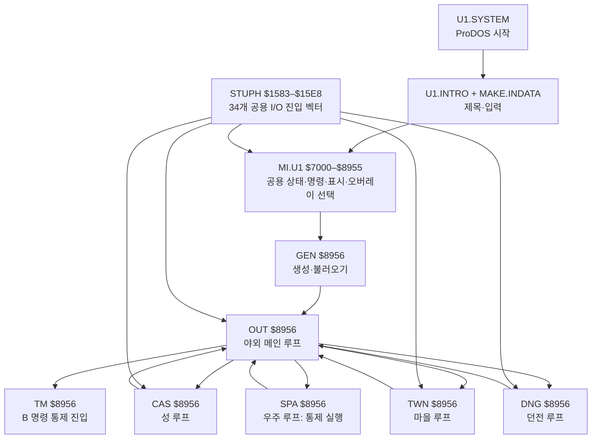

# 실행 구조의 큰 뼈대

이 문서는 게임을 포팅 가능한 구조로 이해하기 위한 **호출·상태·입출력 지도**다. 주소가 같은 `$8956`도 로드된 오버레이에 따라 전혀 다른 코드다. 아래에서 `실행`은 비공개 에뮬레이터 추적으로 도달한 지점, `바이트`는 재조립해 원본과 비교한 범위, `정적`은 파일과 선형 초안을 읽은 가설을 뜻한다. `정적` 결과를 실행 사실로 취급하지 않는다.

이 구조를 [Ghidra 호출 지도](ghidra-call-atlas.md)의 독립된 12개 프로그램과 대조했다. 검증된 진입점·간접 핸들러·공용 벡터로 보강한 Ghidra 함수 464개와 직접 호출 969개는 **검토할 후보**다. 여섯 모듈의 간접 연결은 [공용 키·핸들러 행렬](command-dispatch-matrix.md)에 따로 묶었다. 공개된 바이트 일치 구간 91개의 정확한 위치는 [어셈블리 주소표](assembly-atlas.md)에 있다. [코드·데이터 장부](code-data-ledger.md)와 [메모리·제로 페이지 지도](memory-and-zero-page.md)는 검증 범위와 미분류 주소의 수명을 연결한다.

`CAS`·`TWN`·`DNG`·`SPA`에서 `OUT`으로 가는 코드는 확인되었지만, 모든 복귀 조건을 실행한 것은 아니다. `OUT`의 B 명령으로 `TM`에 들어가는 조건부 분기를 통제 실행했으며, 탈것과 네 플래그를 실제 플레이에서 얻는 경로 및 결말은 미확인이다. 파일 로드·메모리 교체의 근거는 [의존 관계](dependency-map.md)와 [모듈 선택](module-dispatch.md)에 있다.

메인 루프 사이의 **퀘스트 상태 전이**도 연결했다. `CAS`가 여덟 의뢰를 활성화하고, `OUT`의 랜드마크 또는 `DNG`의 특정 몬스터 처치가 완료 표시를 만든다. 성으로 돌아가면 보상이 지급된다. 네 보석은 `TM` 진입 관문에 쓰인다. 성의 또 다른 출구는 야외에 최종 탈것을 생성하도록 요청한다. [상태 흐름과 통제 실행](quest-and-final-craft.md)에 생산자·소비자 주소를 정리했다.

## 루프의 공통 형태

| 모듈 | 루프와 한 회전의 관찰된 순서 | 근거 |
| --- | --- | --- |
| `GEN` | `$89FD` 메뉴 키 → `A` 신규 생성 또는 `B` 불러오기 → 저장 후 메뉴 또는 `$8AC0 → $88FB`으로 야외 진입 | [메뉴 조각](../disasm/GEN-menu.s) 바이트·실행, [GEN 기록](../disasm/GEN.md) |
| `OUT` | `$89A1` 공용 상태 표시 `$836E` → HP·식량 확인 → `$8A6A` 입력 → `$89CB` 공용 명령 해석 `$82A2` → 포인터 테이블 핸들러 → `$96B0` 후처리 → `$8995` 경유 반복 | 첫 입력·명령 실행, [키 폴](../disasm/OUT-key-poll.s) 바이트, [OUT 기록](../disasm/OUT.md). 전체 루프 바이트 분류는 미완료 |
| `CAS` | `$8A31` HP·식량 확인 → `$89E6` 입력/해석 → `$8A5F` 부근 포인터 테이블 핸들러 → `$9804` 후처리 → 반복 | 첫 키·이동·전투 실행, [키 폴](../disasm/CAS-key-poll.s) 바이트, [CAS 기록](../disasm/CAS.md) |
| `TWN` | `$8A28` HP·식량 확인 → `$89E4` 입력/해석 → `$8A56` 부근 포인터 테이블 핸들러 → `$9F07` 후처리 → 반복 | 첫 키·상점 실행, [TWN 기록](../disasm/TWN.md). 루프의 각 호출 의미는 추가 확인 필요 |
| `DNG` | `$8DE6` 사전 처리 `$8982` → HP·식량 확인 → `$8D99` 입력/해석 → `$8E14` 부근 포인터 테이블 핸들러 → `$98EC` 몬스터/턴 처리 → 반복 | 첫 키·이동·전투 실행, [키 폴](../disasm/DNG-key-poll.s) 바이트, [DNG 기록](../disasm/DNG.md) |
| `SPA` | `$8A53` 반복 → `$8A5F` 키 읽기 `$15C2` → `$82A2` 공용 해석 → `$8AA4`의 모듈 핸들러 표 → `$8AB3` 상태 갱신 → 반복 | B 명령 통제 진입 뒤 Space 한 턴과 다음 폴까지 실행. [입력 조각](../disasm/SPA-key-dispatch.s) 바이트 일치; 실제 탈것 획득 조건은 미확인 |
| `TM` | `$8E5E` 반복 → `$8E67` 공용 표시 `$836E` → `$9815` 자체 입력 → `$8E8E` 공용 해석 `$82A2` → `$8EA8` 핸들러 표 → `$8E5E` 복귀 | B 명령 통제 진입, 네 Space 페이지, 메인 루프의 Space 한 턴과 다음 폴까지 실행. [디스패치](../disasm/TM-command-dispatch.s) 바이트 일치; 정상 플레이 전제·결말은 미확인 |

`CAS`와 `TWN`의 루프 형태는 특히 비슷하다. 동일한 2차원 지도·입력 프레임을 공유할 가능성이 크지만, 구조가 비슷하다는 사실만으로 명령의 의미까지 동일하다고 가정하지 않는다. 위의 루프 주소는 선형 초안의 코드 위치와 실행 체크포인트를 대조했다. 각 호출의 모든 부작용은 아직 분류하지 않았다.

## 공용 서비스와 I/O 경계

| 층 | 알려진 호출·상태 | 확인 수준과 남은 일 |
| --- | --- | --- |
| 오버레이 선택 | `MI.U1` `$88FD–$893C`; 이름 표 `$7E16`, 오버레이 시작 `$8956` | [선택 조각](../disasm/MI.U1-selector.s) 바이트. `GEN`, `OUT`, `CAS`, `TWN`, `DNG` 실행 |
| 공용 명령 해석 | `$827D`가 일부 키를 방향 코드로 바꾸고 `$82A2`가 `$7E53–$7E6C` 표에서 찾음. 성공 시 X가 2배 인덱스가 되어 모듈별 핸들러 주소표를 가리킴 | `OUT`의 `P` 거절·Space 수락과 `DNG`의 `W` 거절·Up 수락 실행. 모든 키와 플래그 계약은 미완료 |
| 키보드 래치·소비 | `STUPH $1D64–$1D7E`가 `$C000`을 읽고 `$74–$77` 버퍼 및 `$78` 길이를 갱신하며 `$C010` 스트로브를 지움. 실내 `$1D97`은 `$1D7F`의 제한 폴을 거치고, 야외 `$1DA3`은 `$1C39`에서 지도 19×9 타일을 화면 RAM으로 그린 뒤 버퍼를 확인한다. 둘은 `$1DAD`에서 합류해 첫 바이트를 정규화하고 큐를 한 칸 당긴다. | [래치 27바이트](../disasm/STUPH-keyboard-latch.s)와 [입력 분기 88바이트](../disasm/STUPH-input-dispatch.s) 재조립. [$1DD6 준비 루틴 27바이트](../disasm/STUPH-input-prelude.s)도 재조립해 X/Y 보관과 자기 수정 피연산자를 확인. [$1C39 야외 그리기 299바이트](../disasm/STUPH-outdoor-draw.s)와 첫 폴의 화면 RAM 5,362바이트 변경도 확인. 타일별 픽셀·색과 실제 키 타이밍은 추가 추적 필요 |
| 공용 턴·상태 | `$82E2–$8330`의 십진 연산이 턴 카운터와 식량을 갱신. `$15B9 → $1DF1`은 공용 난수 | [턴 갱신](../disasm/MI.U1-turn-update.s), [난수](../disasm/STUPH-random.s) 바이트·일부 실행. 모든 모듈의 호출 조건은 미완료 |
| 공용 표시 | `OUT` 루프의 `$836E`는 HP·식량·경험·Coin 값을 읽음. `JSR $8119` 뒤의 인라인 문구는 `$8037 → $8068 → $8062 → STUPH $15B0 → $1A1D`로 이어짐. `$1200/$12C0` 행 주소표와 `$2000/$4000` 화면 페이지가 사용됨 | [값 출력](../disasm/MI.U1-status-values.s)과 [문구 해석](../disasm/MI.U1-inline-text.s)·[문자 출력](../disasm/MI.U1-text-control.s) 바이트. [야외 글리프](shared-services.md#첫-출력-경로-실행-관측)의 12 화면 메모리 바이트 변경과 다음 프레임 픽셀 해시 변경을 실행 확인. 정확한 픽셀·색 대응은 미확인 |
| 지도·그림 | `CAS`/`TWN`은 `TCMAPS`를 `$B400–$B6FF`로 복사하고 `MAPCHARS`를 `$B000`에 로드. `CAS`는 지도 표시 동안 1,024바이트를 `$0800`과 교환해 `STUPH $1A58` 글리프 루틴이 읽게 함. `DNG`는 `$B099`의 11×11 작업 지도를 생성. `OUT`은 `$6000` 지도를 조회 | `CAS`의 글리프 교환·첫 렌더링 실행, 128×8 데이터 왕복 확인. 글리프 비트→픽셀·색·페이지 의미는 미확인 |
| 소리·시간 | `STUPH`에는 `$C030` 스피커 토글과 `$C019` 관련 대기가 보임. `SPA`에도 `$C030` 접근이 있음 | 정적 후보. 소리 이벤트, 길이, 게임 턴과 프레임 시간의 관계는 미측정 |
| 파일 I/O | ProDOS `$B7xx` 호출과 `STUPH` `$1589 → $1679` 로더가 파일을 읽고 `$8956`을 교체. 플레이어 저장/불러오기는 별도 `U1.PLAYER` 볼륨 | 부트·오버레이·플레이어 저장 실행. 실패 경로와 모든 데이터 파일의 수명은 추가 분류 필요 |

## 이 구조를 완성하는 순서

1. [공용 서비스 지도](shared-services.md)의 34개 `STUPH` 벡터를 **호출자 → 실제 대상 → 읽는/쓰는 상태 → 화면·소리·키·디스크 효과**로 분류한다. 우선 `$15C2/$15C5` 입력과 `$1592/$1598/$15A1/$15B0` 표시 경로를 한 프레임까지 추적한다.
2. `MI.U1`의 공용 명령 해석, 표시, 턴 갱신, 파일 전환 계약을 작은 루틴 단위로 확정한다. `OUT`과 `CAS/TWN/DNG`의 한 루프에서 같은 입력이 어떤 공용 코드를 지나고 언제 상태·화면이 갱신되는지 비교한다.
3. `SPA`와 `TM`의 루프·입력·출력·전환 주소를 찾아 위 표의 빈칸을 채운다. 그 뒤 각 모듈 핸들러 표에 명령별 규칙을 추가한다.
4. 대표 프레임 하나에서 키 입력부터 화면 메모리·스피커까지의 호출과 변경 바이트를 기록한다. 이 프레임을 macOS 포팅의 첫 비교 시나리오로 삼는다.

이 단계의 산출물은 개별 게임 명령의 긴 로그보다 **완전한 호출 경로와 상태/입출력 계약**이다. 세부 게임 규칙은 이 지도에서 해당 루프·핸들러·공용 서비스 아래에 채운다.

첫 `OUT`/`DNG` 턴의 동일 입력 비교와 `SPA`/`TM` 통제 진입, 메모리 수명 표본은 [한 턴 계약](turn-contracts.md)에 있다.
