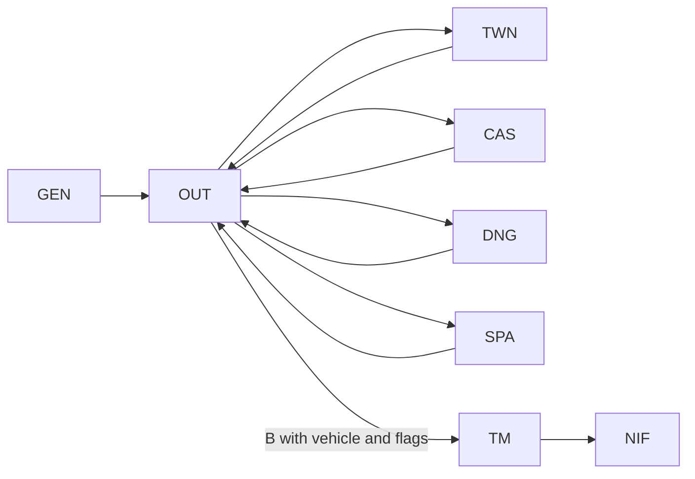

# Original game structure

This reference summarizes module responsibilities and observed transitions.
For the native host and translation model, read [architecture](architecture.md).
For current validation boundaries, read [status](status.md).

| Module | Responsibility | Transition evidence |
| --- | --- | --- |
| `GEN` | Character creation and previous-game menu | `$89FD` distinguishes A/B; load/play reaches `$8AC0 → $88FB` |
| `OUT` | Outdoor map, movement, encounters, vehicles and spells | E selects CAS/TWN/DNG; B selects SPA/TM after vehicle/flag checks |
| `TWN` | Town map, shops, equipment and combat | Uses TCMAPS/MAPCHARS; `$8ABF` selects OUT |
| `CAS` | Castles, king/princess interactions, shops and combat | Uses TCMAPS/MAPCHARS; `$8BFD` selects OUT |
| `DNG` | Dungeon direction, levels, combat and containers | K at the depth-one entrance lowers depth to zero and selects OUT |
| `SPA` | Space flight, shield, fuel, docking and navigation | OUT B boarding; `$8FAA` selects OUT; V has a separate input/command table |
| `TM` | Time-machine sequence and final confrontation | Qualified OUT B entry; four opening pages; victory loads NIF ending data |

These arrows summarize known routes, not every possible transition condition.
SPA/TM integration tests supply vehicle/map/qualification fixtures. Normal
acquisition of their prerequisites is a separate validation task.

## Shared pieces and memory lifetimes

- `MI.U1` provides common state, utilities and module selection below `$8956`.
  Its original `$8956–$89BC` loader tail is replaced by the selected overlay.
- `STUPH` combines graphics with shared routines behind 34 jump vectors at
  `$1583–$15E8`, including keyboard, display, randomness and sound services.
- `TCMAPS` contains ten packed map slots; the 764-byte stride and 768-byte runtime
  copy require careful treatment at record/file boundaries.
- `MAPCHARS` holds 128 eight-row glyphs in scanline planes. Town/castle code
  loads it separately and swaps glyph data for map rendering.
- `NIF` contains 7,680 packed image bytes used by the original ending copy/render
  path. Its final HGR rows have been compared against the local data.
- `MAKE.INDATA` runs during the intro and relocates support payloads. Its catalog
  load range is not its final runtime residence map.

See the [file map](file-map.md), [dependencies](dependency-map.md), and
[file-by-file evidence](../disasm/README.md) for addresses and details.

## Remaining interpretation

Working execution does not imply complete semantic recovery. Mixed code/data
classification, shared-state field meanings, all command rules and boundary
cases, and natural end-to-end progression still need work. The
[documentation index](README.md) separates current native reports from older
research snapshots and detailed Korean notes.
