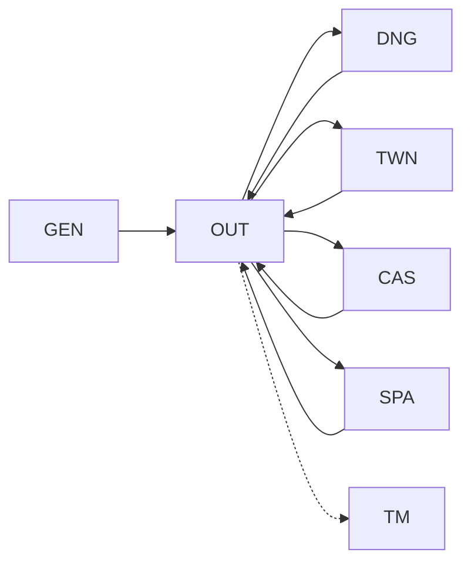

# Game structure: current map

This is a working map from file names, entry code, visible text, and static transitions. The category names describe observed screen or code content; precise game rules still require routine-level tracing.

For the shared engine, per-module main loops, keyboard, rendering, and I/O boundaries, see [execution architecture](execution-architecture.md).

| Module | Visible responsibility | Observed transition evidence |
| --- | --- | --- |
| `GEN` | New character and previous-game menu; character attributes and choices | Input at `$89FD` distinguishes `A` and `B`. The observed continue path at `$8AC0` jumps to the shared `OUT` entry `$88FB`. |
| `OUT` | Outdoor map, movement, encounters, craft, and spells | `$8EFA` dispatches to other modules. `$8D6E` selects `SPA`; `$90FF–$9137` selects `CAS`, `TWN`, or `DNG`. |
| `DNG` | Dungeon directions, levels, combat, containers | `K` on the first entrance tile `$08` lowers depth 1→0; runtime reached `$9725` and reloaded `OUT`, restoring outdoor `(43,15)`. |
| `TWN` | Town map, buying, equipment, combat | Refers to `TCMAPS` and `MAPCHARS`; `$8ABF` jumps to the shared `OUT` entry. |
| `CAS` | Castle map and princess sequence, shops and combat | Refers to `TCMAPS` and `MAPCHARS`; `$8BFD` jumps to the shared `OUT` entry. |
| `SPA` | Spacecraft, shield, fuel, docking, navigation | `$8FAA` jumps to the shared `OUT` entry. |
| `TM` | Time machine sequence and Mondain confrontation | Starts with a jump from `$8956` to `$8AD7`; refers to `NIF`. Return or completion path not yet traced. |

The dashed `OUT` to `TM` edge represents a likely gameplay progression, not a traced call. The other arrows reflect direct selector or return paths found in code; their gameplay conditions are still under study. Additional transitions may exist.

## Shared pieces

- `MI.U1` at `$7000–$8955` provides state, utility routines, and the module selector. Its original `$8956–$89BC` loader is replaced by the selected module.
- `STUPH` combines display data with code reached through its `$1583–$15E5` jump table.
- `MAPCHARS`, `TCMAPS`, and `NIF` appear to be module-specific data. Their formats are not yet decoded.
- `MAKE.INDATA` is loaded during the intro path; its exact role is still under study.

## Open work

The main unresolved parts are the player/state layout near `$7E00`, input dispatch within `OUT`, save/load format, combat formulas, map encodings, the selection of `TM`, and the final completion path. Each item should be backed by traced addresses and, where needed, emulator observation.
