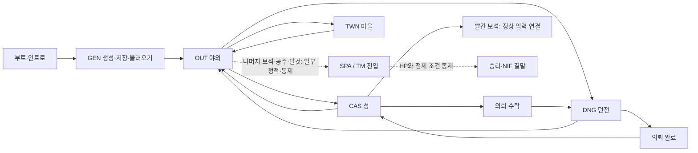

# Ultima I Apple II 게임 진행 중심 역공학 리포트

**대상:** 1986년 Apple II ProDOS판, 이 저장소의 로컬 추출 파일 16개  
**기준:** 2026-10-21의 공개 분석과 비공개 실행 추적  
**목적:** 게임을 플레이하는 순서로 코드, 키보드, 그래픽, 소리, 메모리의 연결을 읽고 macOS 포트에 필요한 계약과 빈칸을 찾는다.

이 문서는 [종합 성과·빈칸 리포트](consolidated-report-2026-10-21.md)의 **게임 진행 순서별 색인**이다. 특정 장면의 첫 루프를 확인했다는 사실을 그 장면의 모든 규칙이 밝혀졌다는 뜻으로 쓰지 않는다. 아래에서 **연속 실행**은 기록된 시작 스냅샷부터 메모리 개입 없이 정상 입력으로 이어 간 경로, **통제 실행**은 명시한 메모리 필드를 바꾸고 원본 코드를 계속 실행한 경로, **바이트 확인**은 검토한 어셈블리를 재조립해 원본과 대조한 경로다. 자세한 검증기와 주소는 링크한 파일에 있다.

## 1. 플레이 경로와 근거의 경계

`U1.SYSTEM → U1.INTRO → MAKE.INDATA → MI.U1 → STUPH → GEN → OUT`의 로드와 첫 입력은 실행 확인했다. `OUT`에서 성·마을·던전 진입과 복귀, 우주·시간 모듈의 **통제 진입**도 확인했다. 왕의 홀수 의뢰 **한 개**는 보존된 야외 시작 스냅샷부터 이동 → 성에서 수락 → 던전 3층 종류 5 처치 → 사망·부활 → 성 복귀 → 빨간 보석 수령까지 정상 입력만으로 이었다. 부트에서 그 보석까지 하나의 중단 없는 재생은 아니다. 나머지 세 보석과 공주·최종 탈것을 정상 입력으로 연속 획득한 기록은 없다. `TM` 승리 실험은 선행 보석 상태를 통제하고 몬데인 HP 한 필드를 낮췄다. [의뢰와 최종 탈것의 상세 계보](quest-and-final-craft.md), [실행 경로와 전환](turn-contracts.md).

## 2. 진행 단계별 다섯 관점

| 게임 단계 | 코드·입력·상태 진행 | 그래픽·픽셀 | 소리 | 메모리·저장 |
| --- | --- | --- | --- | --- |
| 부트·인트로 | `U1.SYSTEM $2088`에서 시작 파일 로드, `U1.INTRO` 키 입력 뒤 `MI.U1`로 이동을 실행 확인. [시작](startup.md) | 인트로 화면의 픽셀 계약은 미완성 | 이벤트와 파형 미분류 | 인트로 `$0800`, 지원 `$1E00`; 뒤에 `STUPH $0800`이 인트로를 덮음 |
| `GEN` | 메뉴 `A` 생성, 능력치 배분·인종·성별·직업·이름, `Y` 저장, `B` 재개를 실행. 다른 선택지와 실패 조건은 일부만 확인. [GEN](../disasm/GEN.md) | 메뉴·선택 화면은 출력 경로만 일부 파악; 픽셀 전수 대조 없음 | 선택·저장 이벤트 연결 미확인 | `U1.VARS` 458바이트 저장·재로드 일치; 초기 필드 전수 분류는 미완료. [저장 기록](../disasm/U1.VARS.md) |
| `OUT` 야외 | `$89A1` 루프에서 입력 → `$82A2` 해석 → 핸들러 → 상태·표시 → 다음 입력. 이동·Space·Q·장소 진입·부활 일부 확인. [한 턴](turn-contracts.md), [OUT](../disasm/OUT.md) | 19×9 타일 창을 그리는 `$1C39` 299바이트 재조립. 타일 대조와 10개 HGR 완료 프레임 총 1,075,200픽셀 색 일치. [렌더링](outdoor-rendering.md) | 야외 명령과 소리 ID의 대응은 미확인 | 지도 `$6000`, 플레이어 `$7E6D–$8036`; 네 세계 경계의 지도 교체·좌표 랩을 통제 실행. Q 저장·B 재로드 바이트 왕복 확인 |
| `CAS`·`TWN` | 각자 이동·충돌, 성의 왕 대화/전투, 마을 식량 구매 가격 경계를 일부 확인. [성](../disasm/CAS.md), [마을](../disasm/TWN.md) | `TCMAPS` 작업 지도와 `MAPCHARS` 글리프 교환. 성 글리프 한 패턴의 14×8 픽셀 효과 대조. 전체 NPC·상점 화면은 미확인 | 거래·전투 이벤트 소리 연결 미확인 | `$B400–$B6FF` 지도 복사; `$00/$01`은 실내 좌표로 교체, 야외 복귀 좌표는 `$7E73/$7E74`에 유지 |
| `DNG` | 1–3층 생성·계단·이동, 몬스터 슬롯·명중·피해 일부와 의뢰 종류 5 처치를 확인. 모든 깊이·함정·보물은 미확인. [지도](dungeon-map.md), [전투](dungeon-combat.md) | 11×11 작업 지도 확인. 던전 시야의 전체 화면 픽셀·색 계약은 미확인 | 몬스터·무기 이벤트 소리 연결 미확인 | `$B099` 작업 지도, `$A4E8/$A4E9` 로컬 좌표; 야외 `$00/$01`을 던전 좌표로 해석하지 않음 |
| `SPA` | 야외 B 탑승의 통제 진입, 기본 이동·연료, `V`의 별도 26키 표와 14개 고유 목적지 확인. 도킹·적·방어막의 전 범위는 미확인. [우주](../disasm/SPA.md), [항법](spa-view-commands.md) | 화면 모드·시점별 픽셀 계약은 미완료 | 모듈 안의 `$C030` 접근 후보는 있으나 실제 효과 계약 미완료 | 같은 `$8956` 오버레이를 사용하며 이동/Fuel 상태의 일부 주소·경계를 확인 |
| `TM`·결말 | 통제 진입, 네 도입 페이지, 공격·후퇴/회복, 보석 파괴 관문, HP 한 필드 통제 승리 확인. 자연 전투 완주는 검증하지 않음. [TM](../disasm/TM.md) | `NIF` 192×40바이트, 192회 아래쪽부터 채우는 행 복사, 두 HGR 페이지의 화면 뒤 준비→전환, 최종 560×192 프레임 **107,520픽셀 색 일치**. [NIF](../disasm/NIF.md) | 결말의 소리 ID·파형은 미분류 | `$4000` 로드 뒤 `$6000` 버퍼로 8 KiB 이동; 실제 행 원본은 7,680바이트이며 마지막 512바이트는 애니메이션 소스 밖 |

이 표의 **미확인**은 해당 기능이 게임에 없다는 뜻이 아니다. 특히 `SPA/TM`의 통제 경로를 정상 플레이로 연결하거나, 한 타일·한 글리프의 픽셀 증거를 모든 장면으로 일반화하지 않는다.

## 3. 한 턴의 코드와 키보드 입출력

공통 뼈대는 **하드웨어 래치 → 공용 키 버퍼 → 명령 검색 → 현재 오버레이의 간접 핸들러 → 장면별 턴/표시 → 다음 입력**이다. `$C000` 키 값, `$C010` 스트로브, `$74–$77` 네 바이트와 `$78` 길이는 `STUPH $1D64`에서 확인했다. `$1DAD`가 버퍼의 첫 키를 소비·정규화하고, `MI.U1 $82A2`가 공용 26키 표를 찾는다. 성공하면 모듈별 16비트 대상 포인터로 이동한다. 여섯 오버레이의 일반 포인터 156개와 `SPA V`의 26개 별도 포인터는 원본·Ghidra 양쪽에서 대조했다. [입력 서비스](shared-services.md), [명령 행렬](command-dispatch-matrix.md).

입력 폴 전에 실행되는 일이 장면마다 다르다. `OUT $15C5 → $1DA3`는 야외 지도를 다시 그리는 `$1C39`를 지난 뒤 버퍼를 확인한다. `CAS/TWN/DNG/SPA $15C2 → $1D97`은 실내 경로를 쓴다. `TM $9815/$9827`은 자체 대기를 거쳐 공용 명령 해석으로 합류한다. 첫 Up의 `OUT`/`DNG`와 `CAS`/`TWN`, 첫 Space의 `SPA`/`TM`에서 핸들러 주소, 상태 변화, 다음 입력 복귀를 비교했다. **동일한 공용 키 해석은 동일한 턴 비용이나 화면 효과를 뜻하지 않는다.** [턴별 실행 표](turn-contracts.md).

키 누름 유지·반복, 버퍼 가득 참, 폴 간격, 입력 대기 중의 시간 진행은 아직 모든 장면에서 검증되지 않았다. macOS 포트가 이벤트 기반 키 입력을 쓰더라도 이 경계의 관찰 가능한 결과를 따로 재생해야 한다.

## 4. 그래픽과 픽셀 데이터의 변환

화면은 **게임 데이터 → 장면 렌더러 → Apple II HGR 메모리·소프트 스위치 → 픽셀** 순서로 추적한다. 원본 타일이나 글리프를 곧바로 완성된 macOS 이미지로 취급하면 인접 바이트와 HGR 색 위상, 페이지 전환의 효과를 잃을 수 있다.

- **야외:** `OUT` 지도 `$6000`에서 19×9 창을 만들고 `STUPH $1C39`가 HGR 화면에 쓴다. 한 타일의 바이트 변경은 완료 프레임의 158픽셀에 영향을 줬다. 이웃 비트·위상 팔레트가 10개 완료 프레임의 모든 1,075,200픽셀을 예측했다. 이는 해당 **에뮬레이터 출력**의 계약이다. [픽셀 근거](outdoor-rendering.md).
- **성·마을:** `TCMAPS`는 10개 × 764바이트 레코드인데 복사 루틴은 768바이트를 읽는다. `CAS` 마지막 슬롯의 나머지 4바이트는 파일 뒤의 상속 RAM이다. `MAPCHARS`는 128개 글리프 × 8 스캔라인이며 한 글리프의 14×8 화면 효과를 통제 확인했다. [지도](../disasm/TCMAPS.md), [글리프](../disasm/MAPCHARS.md).
- **던전·우주:** 지도/항법 상태와 화면 렌더러의 관계는 일부만 연결됐다. 픽셀·색·모드 전수 비교 자료가 필요하다.
- **결말:** `NIF` 7,680바이트가 192개 HGR 행으로 쓰인다. 홀수 행은 HGR 2페이지, 짝수 행은 1페이지를 화면 뒤에서 준비하고 `$15AD` 뒤 표시 페이지가 바뀐다. 첫 행 사이 간격은 116,977, 이후 190개는 각각 119,167–119,254 에뮬레이트 CPU 사이클이다. 최종 HGR 1페이지와 캡처 프레임 107,520픽셀은 원본에서 계산한 검정·흰색·파랑·주황 값과 모두 일치했다. 실제 Apple II의 아날로그 합성 영상 색감은 별개다. [형식·프레임·색 근거](../disasm/NIF.md).

## 5. 소리와 시간

`STUPH $15CB`는 짝수 소리 ID 아홉 개를 간접 주소표로 선택하며 `$1581` 활성 플래그를 확인한다. `$15CE/$15D1`은 `$79–$7C` 대기열에 넣고 첫 항목을 재생한다. 효과 ID `$0E/$10`을 통제 실행했을 때 `$C030` 스피커 접근은 각각 16/50회, 접근 간 간격은 6,441/1,666 CPU 사이클이었다. Ctrl-N 설정은 저장 필드 `$7E72`와 `$1581`에 반영된다. [소리 경로](shared-services.md), [설정 토글](../disasm/MI.U1.md).

이것은 **소리 생성기의 구조와 효과 두 개의 펄스 간격**이다. 어떤 게임 이벤트가 어떤 ID를 큐에 넣는지, 아홉 효과 전체의 길이·무음·합성된 출력, 화면·턴과 소리의 동기화는 아직 포트 명세로 닫히지 않았다. `NIF`의 행 간 CPU 사이클은 결말 화면의 기준이지만 host 시간만 재면 재현되지 않는다.

## 6. 메모리 관리·파일·저장

`MI.U1 $7000–$8955`와 `STUPH $0800–$1FFF`는 게임 중 남고, `GEN/OUT/CAS/TWN/DNG/SPA/TM` 중 한 파일이 `$8956`부터 다른 파일을 덮는다. 인트로의 `$0800`과 게임 중 STUPH의 `$0800`, 야외 지도·다른 데이터의 `$4000/$6000`도 시점별로 의미가 바뀐다. 같은 주소의 Ghidra 후보를 한 프로그램으로 합치면 잘못된 호출 관계가 생긴다. [의존 지도](dependency-map.md), [메모리 수명](memory-and-zero-page.md).

제로 페이지는 장면 전역 구조체가 아니다. `$00/$01`은 야외·성·마을의 현지 좌표, 던전은 `$A4E8/$A4E9` 로컬 좌표를 쓴다. `$72/$73`은 야외 지도 포인터, 성의 임시 좌표/전투값, 마을의 16비트 가격으로 재사용된다. `$74–$78` 키 버퍼와 `$79–$7D` 소리 큐도 나란히 놓인 별도 상태다. 반면 `$7E6D–$8036` 458바이트의 플레이어 기록은 장면 사이에 유지되고 `GEN` 저장/불러오기와 `OUT Q → GEN B` 왕복을 확인했다. **137바이트 접두부의 나머지 필드, 간접 접근, 재시작·오류 경로**는 미분류다. [기록과 필드](../disasm/U1.VARS.md), [필드 참조 후보](player-access-atlas.md).

파일 경계와 실행 경계가 항상 같지는 않다. `TCMAPS` 최종 복사의 4바이트 초과분과 `NIF` 로드 뒤 8 KiB 이동의 512바이트 여분을 확인했다. `NIF` 여분은 최종 행 원본에 들어가지 않는다. 통제한 `TCMAPS` 여분은 첫 성 입력까지 눈에 띄는 부작용이 없었으나 그 뒤의 소비자는 미확인이다. [데이터 근거](../disasm/TCMAPS.md), [결말 근거](../disasm/NIF.md).

## 7. 리포트가 드러낸 포팅 전 필수 빈칸

| 우선 | 게임 진행에서 드러난 빈칸 | 닫는 방법과 산출물 |
| --- | --- | --- |
| 1 | `GEN`의 다른 선택·검증, `OUT`의 전투·경제·차량, `CAS/TWN`의 NPC·상점, `DNG`의 나머지 층·함정·보물, `SPA`의 도킹·적 등 **명령 계약**이 넓게 비어 있다. | [명령 행렬](command-dispatch-matrix.md)의 각 키에 전제 조건 → 상태·난수·자원 → 화면·소리 → 다음 루프와 실패/경계값을 입력 재생으로 붙인다. |
| 2 | 빨간 보석 1개를 제외한 **정상 입력 퀘스트·공주·탈것 경로**가 결말과 연속으로 이어지지 않았다. | 나머지 상태 생산자와 소비자를 주소로 확인하고, 최소한 각 관문의 통제 실행 및 하나의 실제 획득 경로를 보존한다. 긴 몬데인 전투 반복은 분기 계약 검증에 필요하지 않다. |
| 3 | 실제 **이벤트 → 소리 ID → 큐 → 스피커/오디오**와 실내·던전·우주의 화면 픽셀 계약이 부족하다. | 주요 장면 한 턴씩 입력·화면 페이지/프레임·소리·CPU 사이클을 함께 캡처하고 비공개 기준 결과와 비교한다. |
| 4 | 플레이어 기록·제로 페이지·상주/오버레이의 일부 읽기/쓰기 수명과 코드·데이터 경계가 미분류다. | [코드·데이터 장부](code-data-ledger.md)의 구간과 [Ghidra 호출 후보](ghidra-call-atlas.md)를 실행 목표·바이트 일치·필드별 생산자/소비자로 좁힌다. 후보 수를 완료율로 쓰지 않는다. |
| 5 | 저장 실패·재시작·사망 이후 상태 보존, 원본과 macOS 구현의 **차등 테스트**가 없다. | 동일한 입력·초기 저장 상태에서 상태 레코드, 메인/보조 화면, 프레임, 소리, 시간의 차이를 기록하는 수용 시나리오를 만든다. [포팅 준비 기준](porting-roadmap.md#포팅-준비-수용-기준). |

**현재 판정:** 핵심 실행 구조와 일부 대표 규칙·화면의 재현 근거가 있다. 전체 게임에 대해 원작 충실도를 보증할 만큼 명령·데이터·소리·예외 경로가 닫히지는 않았다. 이 리포트는 포트 구현의 출발 설계와 검증 계획으로 사용할 수 있으며, [완료 수용 기준](porting-roadmap.md#포팅-준비-수용-기준)을 통과했다는 선언은 아니다.

## 8. 재현과 공개 범위

`python3 tools/check_all.py`는 현재 107개 검사 구간을 실행한다. Ghidra 후보는 `python3 tools/ghidra/verify_exports.py`로 별도 확인한다. 런타임 검사 중 다수는 로컬의 원본 추출 파일·디스크·비공개 스냅샷을 요구한다. 공개 저장소에는 도구와 주소·판정만 두고 `extracted/`, `disk/`, `build/`의 원본·캡처·플레이어 디스크는 두지 않는다. [재현 기준](baseline.md), [바이트 일치 조각 98개](assembly-atlas.md), [파일별 코드·데이터 장부](code-data-ledger.md).
