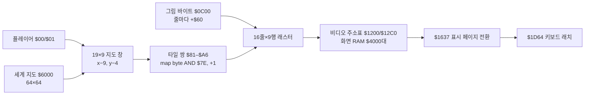

# 야외 지도 타일에서 화면 픽셀까지

대상은 1986년 Apple II ProDOS판의 첫 `OUT` 입력 화면이다. 이 페이지는 [재조립한 `STUPH $1C39–$1D63`](../disasm/STUPH-outdoor-draw.s), 원본 실행 추적, 지도 한 바이트만 바꾼 대조 실행을 연결한다. 아래 픽셀·색 수치는 **이 화면과 이 에뮬레이터 프레임의 관측값**이다.

## 렌더링 경로



`$1C39`는 플레이어 좌표에서 `(x−9,y−4)`를 시작점으로 잡는다. 유효한 행의 지도 포인터는 `$6000+64×row`이고, 열을 Y로 더해 타일 바이트를 읽는다. 타일 코드는 `AND #$7E`를 거쳐 `$81–$A6`에 코드와 그다음 코드의 **두 바이트 인덱스**로 준비된다. 창은 19열×9행이다. 경계 밖의 행·열에는 빈 타일 인덱스를 넣는다. 일부 값 `$20–$58`은 `$1769`와 `$B700,X`를 쓰는 애니메이션 분기를 거친다.

그리기 루프는 타일 행마다 16개의 화면 줄을 쓴다. 각 줄에서 그래픽 원천은 `$0C00`부터 `$60`씩 옮겨지고, 화면 목적지는 `$1200/$12C0` 행 주소표로 계산한다. 코드가 `$1CEB/$1CEC`의 **읽기 피연산자**와 `$1CEE/$1CEF`의 **쓰기 피연산자**를 직접 바꾼다. 마지막에는 `$1637`이 `$C054/$C055` 화면 페이지 선택에 접근하고, 애니메이션 상태를 갱신한 다음 `$1D64`의 키 래치로 흐른다. `OUT`의 `$15C5 → $1DA3` 입력 호출이 이 렌더러를 사용한다.

## 원본 실행에서 관찰한 한 번의 화면 갱신

첫 야외 입력의 비공개 스냅샷을 그대로 실행했다. `$1C39 → $1DA6`에 **130,917 CPU 사이클**이 걸렸다. 호출 전후에 `$2000–$5FFF` 화면 RAM 5,362바이트, `$0C00–$0DFF` 타일 패턴 14바이트가 바뀌었다. `$6000–$6FFF` 지도 원본과 `$1200–$13FF` 행 주소표는 그대로였다. 에뮬레이터 프레임은 2825에서 2833으로 진행했다. [추적기](../tools/trace_stuph_outdoor_draw.py)와 [검증기](../tools/verify_stuph_outdoor_draw.py)가 주소·사이클·스냅샷 계보를 검사한다.

## 지도 한 바이트 대조

동일한 `$1C39` 진입 시점의 왼쪽 위 지도 주소 `$675E`만 `$02→$04`로 바꾸었다. 첫 그리기 종료 직후 지도를 `$02`로 복원했다. 원본과 대조 실행은 같은 CPU 지점·사이클에서 멈췄고, 저장한 전체 메인 RAM에서 **화면 RAM 20바이트만** 달랐다. 모든 변경 주소는 두 바이트짜리 첫 타일 열의 16개 줄 안에 있다.

즉시 읽은 라이브 프레임은 실행마다 화면 전체가 다르게 나와 픽셀 근거로 쓸 수 없었다. 이 실험은 `--inspector` 프레임 링의 **같은 완료 프레임 2834**를 읽는다. 그 프레임에서 바뀐 픽셀은 158개이고 경계는 `x=14–39, y=8–22`다. 첫 타일에 배정된 화면 영역은 두 비디오 바이트 × 7비트 × 2배 가로 표시로 **28×16픽셀**(`x=14–41, y=8–23`)이며, 경계 안의 모든 픽셀이 달라지는 것은 아니다.

| 원본 색 → 변경 색 | 픽셀 수 |
| --- | ---: |
| 검정 `#000000` → 녹색 `#38CB00` | 140 |
| 검정 `#000000` → 흰색 `#FFFFFF` | 10 |
| 녹색 `#38CB00` → 검정 `#000000` | 8 |

`$02→$03`과 `$02→$82` 대조는 전체 RAM·비디오 RAM·완료 프레임 픽셀이 원본과 같았다. 이는 이 렌더러의 `AND #$7E`가 타일 선택에서 비트 0과 7을 제거한다는 코드 해석을 실제 화면으로 확인한다. 그 두 비트가 **다른 게임 로직에서도 무의미하다는 뜻은 아니다**.

같은 위치에서 첫 지도에 실제로 등장하는 짝수 지형 코드 `$00–$0E`도 각각 대조했다. 아래 수치는 원본 `$02`를 해당 값으로 바꿨을 때의 차이이며, 각 실행은 지도를 되돌린 뒤 프레임 2834에서 비교했다.

| 대체 코드 | 화면 RAM 변경 | 픽셀 변경 | 픽셀 차이 경계 | 차이에서 관측한 변경 후 색 |
| --- | ---: | ---: | --- | --- |
| `$00` | 32바이트 | 106 | `x=14–41, y=8–23` | 검정, 파랑 |
| `$04` | 20바이트 | 158 | `x=14–39, y=8–22` | 검정, 녹색, 흰색 |
| `$06` | 31바이트 | 146 | `x=14–43, y=8–23` | 검정, 녹색, 보라, 흰색 |
| `$08` | 28바이트 | 272 | `x=14–41, y=8–22` | 검정, 녹색, 보라, 파랑, 흰색 |
| `$0A` | 28바이트 | 170 | `x=14–41, y=8–22` | 검정, 흰색 |
| `$0C` | 16바이트 | 146 | `x=14–41, y=10–19` | 검정, 녹색, 보라, 흰색 |
| `$0E` | 32바이트 | 152 | `x=14–43, y=8–23` | 검정, 녹색, 보라, 흰색 |

여기서 파랑은 이 에뮬레이터의 `#0DA1FF`, 보라는 `#C734FF`다. `$06/$0E`의 픽셀 차이는 두 비디오 바이트의 명목 영역 끝 `x=41`을 지나 `x=43`까지 닿았다. 한 타일 위치의 색 결과를 다른 화면 좌표·주변 타일에 일반화하지 않는다.

### 이웃 바이트까지 보는 색 계산

사용 중인 a2m의 HGR 렌더러는 현재 화면 바이트의 하위 7비트만 독립적으로 색칠하지 않는다. 각 바이트를 처리할 때 **이전 바이트의 비트 6**, **다음 바이트의 비트 0**, 현재 바이트의 비트 7에 있는 **색 위상**, 화면 바이트 열의 **짝·홀**을 함께 사용한다. 3비트 창을 한 비트씩 옮기며 팔레트 색을 선택하고, 결과 한 비트를 560픽셀 프레임에서 가로 두 픽셀로 표시한다. 그래서 첫 타일의 두 비디오 바이트를 바꾸면 오른쪽 이웃 바이트가 담당하는 첫 두 픽셀의 색도 달라질 수 있다.

```text
window = (next_byte.bit0 << 8) | ((current_byte & $7F) << 1) | previous_byte.bit6
phase  = current_byte.bit7
for bit = 0..6:
    pattern = window & 7
    color = palette[pattern, column parity, phase]
    draw color at x = 14*column + 2*bit and x+1
    window >>= 1
```

이 식과 a2m HGR 팔레트로 저장된 `$4000` 페이지를 독립 해석해, **10개 원본·지형·비트 대조의 6,720픽셀**(`x=14–55,y=8–23`)을 각 완료 프레임 PNG와 하나씩 비교했다. 모두 일치했다. [독립 색 검증기](../tools/verify_outdoor_hgr_palette.py)는 외부 이미지 라이브러리 없이 이 계산을 재현한다. 이것은 **a2m이 표시한 이번 HGR 화면의 색 계약**이다. 실제 Apple II 비디오 출력의 모든 아날로그 색차까지 확정한 것은 아니다. 포팅에서는 타일을 완성된 독립 색 이미지로 붙이기보다 비디오 바이트와 이웃 관계를 보존하는 모델이 필요하다.

[타일 대조 추적기](../tools/trace_outdoor_tile_pixels.py)는 열 실행의 사설 스냅샷과 PNG를 `build/`에만 저장한다. [검증기](../tools/verify_outdoor_tile_pixels.py)는 원본 계보, 개입한 단일 지도 바이트, 복원, 20개 화면 주소, 프레임 번호, 픽셀 경계·색과 비트 대조를 검사한다. 공개 저장소에는 원작 화면 이미지나 원본 그래픽 바이트를 넣지 않는다.

## 포팅에 남은 조건

이 실험은 첫 화면 한 좌표에서 원본과 일곱 대체 지형의 크기·색 결과를 고정한다. 다른 화면 좌표와 이웃 타일 조합, 두 화면 페이지의 전환 시점, 애니메이션 분기, 경계 밖 지도, 키를 누른 상태의 반복 표시를 같은 방식으로 대조해야 전체 야외 렌더러의 포팅 명세가 된다. 현재 관찰한 색을 게임 전체의 팔레트로 일반화할 근거는 아직 없다.
