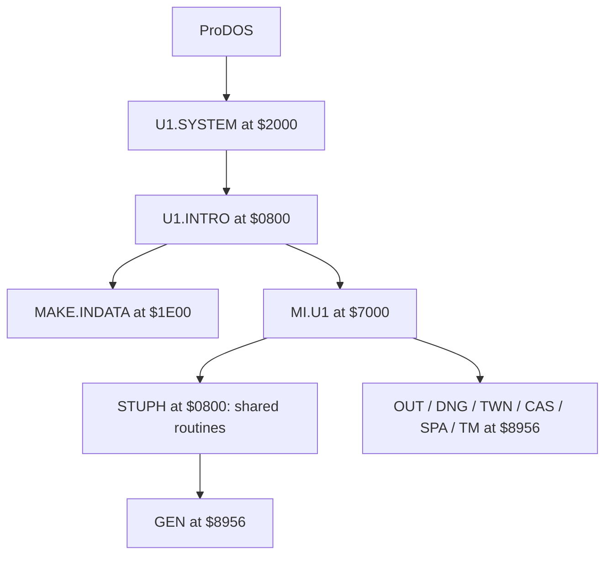

# Startup and module loading

Status: initial static analysis plus a memory-verified runtime entry into `U1.SYSTEM` at `$2088` from a block-equivalent ProDOS-order image. Later transitions still need runtime confirmation. Addresses refer to the local ProDOS extraction.

The supplied WOZ reaches ProDOS's `$21D4` error loop after `GET_PREFIX` returns `A=$27`. The block-equivalent `.po` image boots through to `U1.SYSTEM`; the discrepancy needs investigation before claiming faithful WOZ emulation.

## Confirmed observations

- `U1.SYSTEM` begins with a jump to `$2088`. Its header names `U1.INTRO`. The first runtime snapshot contained ProDOS code (`AC 0F`) at `$2088`; a later capture from the block-equivalent image reached `$2088` with the extracted `U1.SYSTEM` header and entry code (`78 A9`) in memory. The same bytes were confirmed after snapshot restore. Transfer into `U1.INTRO` still needs tracing.
- `U1.INTRO` begins with jumps to `$0F23` and `$0F41`. At `$0F23`, a loader call uses the inline filename `MAKE.INDATA`. Another code path near `$0B50` uses the inline filename `MI.U1`.
- `$0800` enters the `MAKE.INDATA` request path; `$0803` enters at `$0F41` after that request. The intro loop at `$1039–$1056` polls the keyboard and calls `$0B50` when a key arrives. `$0B50` requests `MI.U1` for key values other than `$9B`; `$9B` takes a separate wait-for-next-key path.
- `MI.U1` starts with a jump to `$8956`. At `$7E16` it contains zero-terminated names `GEN`, `OUT`, `DNG`, `TWN`, `CAS`, `SPA`, and `TM` in that order. The routine near `$88FD` loads `GEN` and transfers control to `$8956`.
- The initial `MI.U1` loader at `$8956` loads `STUPH` by inline filename, then reaches the module selector at `$88FD` with accumulator value zero. `STUPH` has 33 three-byte jump stubs at `$1583–$15E5`; these are called throughout the common engine.
- The original `MI.U1` bytes at `$8956` form startup/loader code. Each gameplay module is loaded at the same address and overwrites that code. Each module's first bytes are 6502 code; `TM` starts with a jump to `$8AD7`.
- `TWN` and `CAS` refer to `TCMAPS` and `MAPCHARS`. `TM` refers to `NIF`. The exact load conditions need tracing.

## Working interpretation

The common engine keeps shared state and utility routines below `$8956`, with extra routines in `STUPH`. A loader selects one gameplay module according to game state, then enters it at `$8956`. The initial `MI.U1` tail is only needed before the first module load. Calls back into lower shared addresses are expected. This is a hypothesis to verify by tracing the loader and each module's exit paths.

## Next trace targets

1. `U1.SYSTEM` `$2088`: find the exact ProDOS startup handoff and error path.
2. `U1.INTRO` `$0B50`, `$0F23`, `$0F41`: identify the control paths for intro, support file, and `MI.U1` loading.
3. `MI.U1` `$7E16`, `$88FD–$8955`: name the selection state, loader call, and module return convention; trace the `$1583–$15E5` stubs in `STUPH`.
4. `GEN` `$8956` and `OUT` `$8956`: follow character creation into outdoor play.

The first pass through the module selector is documented in [Gameplay module dispatch](module-dispatch.md).
