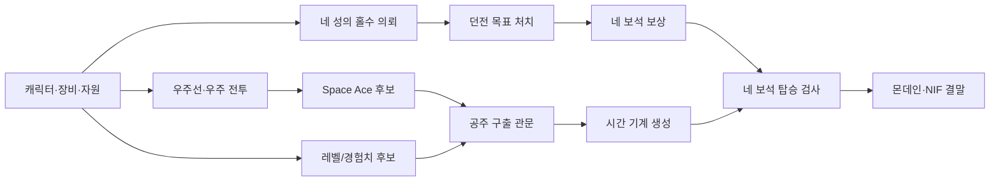

# 공략을 가설 지도처럼 쓰는 게임 진행 조사

이 프로젝트의 대상은 **1986년 Origin Systems Apple II ProDOS판**이다. 공략은 플레이어가 시도할 행동과 목표를 제안한다. 게임 규칙의 근거는 이 저장소의 추출 바이너리, 주소별 코드 검토, 같은 판본의 실행 결과로 확정한다. 따라서 공략 순서를 유일한 진행 순서로 가정하거나, 한 번의 긴 완주를 모든 분기의 증명으로 삼지 않는다. [게임 진행 중심 리포트](gameplay-flow-report.md)와 [증거 수준](porting-fidelity.md)을 함께 읽는다.

## 판본 확인에서 발견한 실제 충돌

- [Gamer Corner의 Apple II Ultima 공략](https://guides.gamercorner.net/ultimai-aii/)은 사이트가 **원래 BASIC판**을 다룬다고 명시한다. 이 저장소의 어셈블리 재제작판에 그대로 적용하지 않는다.
- [ASchultz의 Apple/PC 혼합 공략](https://gamefaqs.gamespot.com/appleii/917774-ultima-i/faqs/9073)은 Apple판과 PC판에 차이가 있다고 설명한다. 공략은 네 보석, 우주, 공주, 시간 기계라는 큰 관문을 제안하지만, 세부 수치·색·지도는 판본별로 재검증한다.
- 실제로 ASchultz 공략은 첫 홀수 성 의뢰 보상을 **흰 보석**으로, 원래 BASIC판을 다루는 [Gamer Corner의 해당 경로](https://guides.gamercorner.net/ultimai-aii/walkthrough/lands-of-lord-british)는 **빨간 보석**으로 설명한다. 이 저장소의 `CAS $963A → $7E75`와 메모리 개입 없는 성 의뢰 1 보상 실행도 **빨간 보석**을 확인했다. [원본 코드와 실행 계보](quest-and-final-craft.md). 색 이름의 불일치는 판본 차이 또는 공략 오류일 수 있으며, 현재 자료만으로 원인을 단정하지 않는다.

공략 텍스트나 지도를 대량으로 복제하지 않는다. 아래 표는 출처의 주장을 짧은 **검사 가설**로 바꾸고 원본 코드와 연결한 것이다.

## 목표를 선행 조건 그래프로 바꾸기

이 그래프는 **의존 관계의 조사 순서**다. 보석 수집, 레벨 상승, 우주 전투는 서로 섞어 진행할 수 있다. 이미 [성 의뢰 1 → 던전 3층 처치 → 빨간 보석](quest-and-final-craft.md)은 저장된 야외 시작 상태에서 정상 입력으로 이어졌다. 다른 보석과 우주·공주 상태는 아직 이와 같은 연속 실행으로 닫히지 않았다.

| 공략에서 얻은 검사 가설 | 이 판본의 현재 연결 | 가장 작은 다음 검증 |
| --- | --- | --- |
| 보석은 성의 던전 의뢰 보상이고 순서를 바꿀 수 있다. | 여덟 의뢰 상태 `$7EA9–$7EB0` 중 홀수 네 개가 깊이·몬스터 종류 검사와 네 보상 루틴으로 이어진다. 빨간 보석만 정상 입력으로 수령했다. | 나머지 세 성의 `수락 → 목표 종류·깊이 → 완료 → 보상`을 각자 재생하고, 이미 받은 보석을 지닌 채 다른 의뢰를 수락하는 순서 교체 한 쌍을 확인한다. |
| 우주에서 적 20척을 파괴하면 Space Ace가 된다. | `SPA $9700–$973F`는 명중 처리 뒤 대상 배열 `$B099,Y`를 줄이고 경험치 100을 더한 다음 `$7EB6`을 증가시켜 20과 비교한다. 바이트를 원본과 대조했고, `CAS`가 이 바이트의 20 경계를 소비하는 것은 실행 확인했다. **자연 우주 전투의 한 처치에서 증가하는지는 미확인**이다. | 우주 전투의 실제 명중/처치 직전 상태를 확보해 `$7EB6:19→20`, 경험치 변화, 축하 문구와 다음 루프를 확인한다. |
| 일정 레벨과 Space Ace 상태에서 공주가 시간 기계를 알려준다. | `CAS $8B65–$8B7A`는 `$7EB6 ≥ 20`과 **출구 보상 후** `$7EE7/$7EE8 ≥ 7000`을 검사한다. 같은 성 스냅샷의 통제 실행에서 격추 수 `19/20`, 진입 경험치 `6499/6500`의 양쪽 경계를 확인했다. 통과 시 `$8BF5`가 `$7EB5=1`을 썼다. **이 값이 레벨 8에 해당하는지는 미확인**이다. | 자연 입력으로 공주를 구출해 출구에 도달하는 경로, 경험치와 우주 격추 수의 생산자, 구출 신호가 실제 세계 지도에 반영되는 연속 경로를 확인한다. |
| 시간 기계는 공주 구출 뒤 나타나며 네 보석이 있어야 탑승한다. | `OUT $9565`가 `$7EB5`에 따라 원시 타일 `$1E`를 만들고, `OUT $8D73–$8D8A`가 `$7E75–$7E78` 네 바이트를 모두 검사한다. 생성과 탑승은 각각 **통제 실행**을 했다. | 실제 공주 경로에서 생성 신호가 생기는지 확인하고, 보석 하나씩 결핍한 네 탑승 대조 실험을 같은 위치에서 실행한다. |
| 몬데인의 보석을 처리하고 전투를 마치면 결말로 간다. | `TM`의 G→보석 상태, A→피해, 낮춘 HP의 승리/실패 분기, `NIF` 로드·행 복사·최종 픽셀을 확인했다. | 정상 HP 전체 전투 반복에 시간을 쓰기보다 보석 상태·HP·거리·방향·무기 등 분기별 최소 경계 상태를 검사한다. [결말 근거](../disasm/TM.md). |

## 자유도에 맞는 조사 단위

1. 공략의 행동을 **입력 문장**이 아니라 `전제 상태 → 명령 → 상태·화면·소리 → 다음 상태`의 관문으로 바꾼다. 예를 들어 “공주를 구한다”를 광대 처치·열쇠·감방 개방·동행·성 출구·경험치/우주 조건·`$7EB5` 생성으로 나눈다.
2. 이미 확보한 비공개 스냅샷을 관문 **바로 앞**에서 분기시킨다. 조건의 참/거짓과 `임계값−1/임계값`을 같은 입력으로 비교한다. 먼저 원본 코드의 조건을 고정하고, 그다음 정상 플레이의 상태 생산자를 찾는다.
3. 각 필수 관문에 정상 입력으로 도달한 **최소 한 경로**를 보존한다. 필요한 선행 조건과 실패 경로는 작은 통제 실험으로 보충한다. 전투·이동의 긴 반복은 대표 로그 하나와 상태 체크포인트로 다룬다.
4. 순서 자유도는 모든 순열 대신 **독립성 검사**로 다룬다. 서로 다른 두 의뢰를 A→B와 B→A로 실행해 퀘스트/보석·저장 결과가 같은지 보고, 중간 사망·재로드와 보상 재방문은 별도 경계로 둔다.
5. 공략 주장, 이 판본의 주소·바이트 증거, 실행 결과를 세 칸으로 분리한다. 일치하면 회귀 시나리오에 넣고, 다르면 공략의 판본·오류 가능성을 기록한다. 공략만으로 포트 규칙을 확정하지 않는다.

성의 공주 출구 수치 경계는 [통제 실행 도구](../tools/trace_cas_princess_gate.py)와 [검증기](../tools/verify_cas_princess_gate.py)로 확인했다. 원본 출구의 긴 대사 호출 `$8AC1`만 `$8B38`으로 건너뛰었고, 500점 보상과 두 비교 및 플래그 쓰기는 원본 그대로 실행했다. 실제 공주 구출 조건 전체를 재현한 결과는 아니다. 다음 묶음은 **우주 처치 계수 `$7EB6`의 생산 경로**, 자연 공주 구출, 진입 경험치 6500과 공략의 레벨 8 관계다.
